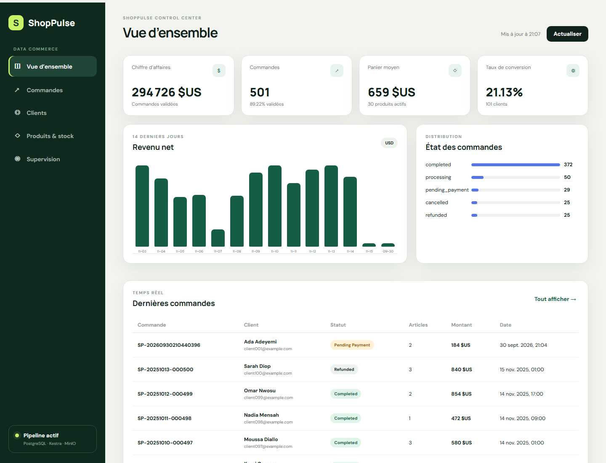
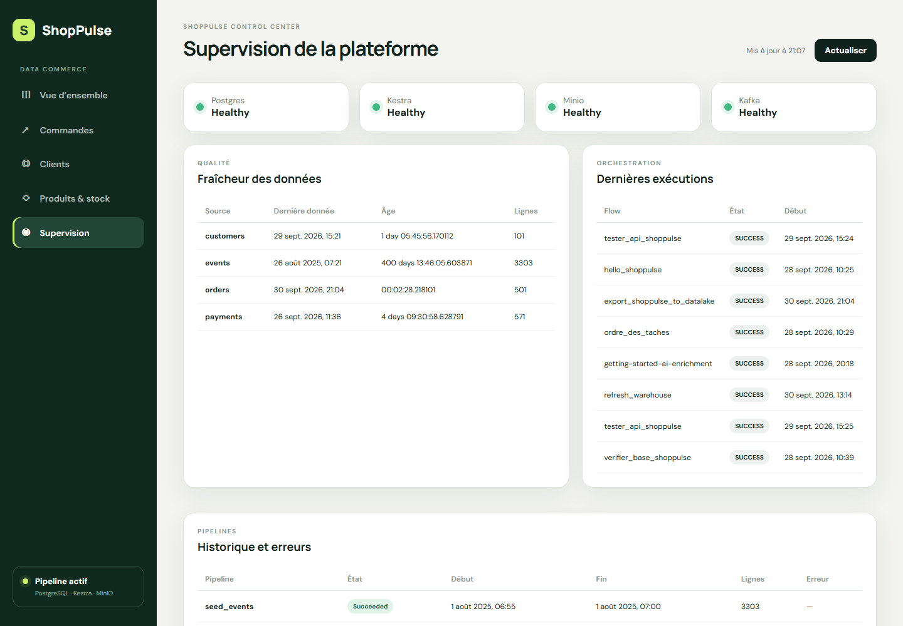

# ShopPulse — Guide final de la plateforme Data Engineering

## 1. Objectif

ShopPulse est une plateforme de données e-commerce complète. Elle collecte des données opérationnelles et temps réel, les conserve dans un Data Lake, les transforme pour l'analyse, puis les expose par une API et un tableau de bord.

## 2. Architecture

```text
Application / API FastAPI
          |
          v
PostgreSQL (schéma shop)
          |
          +--------> Kestra --------> MinIO raw / processed / analytics
          |                              ^
          |                              |
          +--------> dbt ----------> Data Warehouse PostgreSQL
                                         |
Événements simulés --> Kafka --> archivage JSONL
                                         |
                                         v
                                       Spark
                                         |
                                         v
                               Agrégats Parquet dans MinIO

PostgreSQL + Warehouse + Kestra + états des services
                         |
                         v
                    API FastAPI
                         |
                         v
                 Dashboard ShopPulse
```

## 3. Composants

| Composant | Fonction | Accès local |
|---|---|---|
| PostgreSQL | Données e-commerce, vues analytiques et Data Warehouse | `127.0.0.1:5432` |
| pgAdmin | Administration graphique de PostgreSQL | `http://127.0.0.1:5050` |
| Kestra | Orchestration et suivi des pipelines | `http://127.0.0.1:8080` |
| MinIO | Data Lake compatible S3 | API `127.0.0.1:9100` dans la configuration actuelle |
| dbt | Nettoyage, transformation et tests analytiques | Exécution à la demande |
| Kafka | Transport des événements temps réel | `127.0.0.1:9092` |
| Spark | Traitement batch des fichiers JSONL et production Parquet | Exécution à la demande |
| FastAPI | API opérationnelle, analytique et supervision | `http://127.0.0.1:8000` |
| Frontend | Dashboard métier et supervision | `http://127.0.0.1:3000` |

## 4. Démarrage

1. Démarrer Docker Desktop.
2. Ouvrir PowerShell dans `D:\Desktop\project1`.
3. Démarrer la plateforme :

```powershell
.\scripts\platform.ps1 start
```

Afficher l'état :

```powershell
.\scripts\platform.ps1 status
```

Afficher les journaux principaux :

```powershell
.\scripts\platform.ps1 logs
```

## 5. API disponible

| Méthode | Route | Rôle |
|---|---|---|
| GET | `/health` | Santé de l'API et de PostgreSQL |
| GET | `/dashboard` | KPI, chiffre d'affaires et ventes quotidiennes |
| GET | `/customers` | Liste des clients |
| POST | `/customers` | Création protégée d'un client |
| GET | `/products` | Produits et stocks |
| GET | `/orders` | Liste des commandes |
| GET | `/orders/{id}` | Détail d'une commande |
| POST | `/orders` | Création protégée d'une commande |
| GET | `/analytics/products` | Meilleurs produits |
| GET | `/analytics/customers` | Meilleurs clients |
| GET | `/analytics/conversion` | Funnel et taux de conversion |
| GET | `/events/recent` | Événements récents |
| GET | `/supervision` | Services, Kestra, pipelines et fraîcheur |

Les opérations `POST` exigent l'en-tête `X-ShopPulse-API-Key`. La valeur est conservée uniquement dans `.env`.

## 6. Data Lake

```text
shoppulse/
  raw/
    customers/
    products/
    orders/
    order_items/
    events/
    streaming/events/date=.../hour=.../*.jsonl
  processed/
    orders/
    products/
    events/
  analytics/
    daily_sales/
    product_performance/
    customer_summary/
    conversion_funnel/
    streaming_event_summary/date=.../run=.../*.parquet
```

## 7. Streaming et Spark

Démarrer Kafka et l'archivage vers MinIO :

```powershell
.\scripts\streaming.ps1 start
```

Produire 100 événements :

```powershell
.\scripts\streaming.ps1 produce 100
```

Lancer Spark :

```powershell
.\scripts\spark.ps1 run
```

## 8. dbt et Data Warehouse

```powershell
.\scripts\dbt.ps1 run
.\scripts\dbt.ps1 test
.\scripts\dbt.ps1 docs
```

Les modèles finaux sont `sales`, `customers`, `products` et `events`. Les tests vérifient les valeurs obligatoires, l'unicité, les relations et les montants.

## 9. Supervision

La page **Supervision** affiche :

- l'état de PostgreSQL, Kestra, MinIO et Kafka ;
- les dernières exécutions Kestra ;
- la fraîcheur et le volume des sources ;
- les runs du Data Warehouse ;
- les erreurs enregistrées dans les pipelines.

## 10. Sécurité

- Les secrets sont placés dans `.env`, exclu de Git.
- `.env.example` ne contient que des valeurs d'exemple.
- Les mots de passe obligatoires sont validés par Docker Compose.
- Les opérations d'écriture de l'API exigent une clé API.
- Kestra et pgAdmin disposent de leurs propres identifiants.
- Les ports sont liés à `127.0.0.1` et ne sont pas exposés au réseau local.
- Les contraintes PostgreSQL protègent les montants, relations, statuts et stocks.

## 11. Tests complets

```powershell
.\scripts\test-platform.ps1
```

Ce script valide la configuration Docker, PostgreSQL, dbt, le Data Warehouse, les API, la supervision et le frontend.

Résultat de la validation du 30 septembre 2026 :

- flows Kestra d'export et de warehouse : `SUCCESS` ;
- commande de démonstration créée et visible dans l'API ;
- deux lignes de vente présentes dans `warehouse.fact_sales` ;
- modèles dbt : 9/9 réussis ;
- tests dbt : 20/20 réussis ;
- PostgreSQL, Kestra, MinIO et Kafka : `healthy` ;
- frontend : HTTP 200.

## 12. Démonstration

```powershell
.\scripts\demo.ps1
```

Le scénario :

1. crée une commande avec deux produits via l'API sécurisée ;
2. lance l'export PostgreSQL vers MinIO avec Kestra ;
3. actualise le Data Warehouse avec Kestra ;
4. reconstruit les modèles dbt ;
5. vérifie la commande dans l'API ;
6. permet de la montrer dans le dashboard après actualisation.

## 13. Captures

### Dashboard métier



### Supervision


