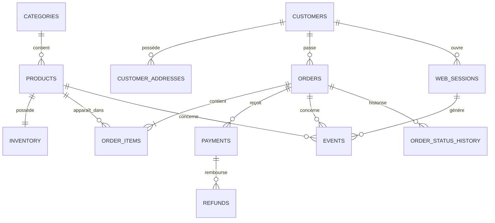

# Modèle de données ShopPulse

## Diagramme relationnel principal

## Granularité des tables

| Table | Une ligne représente |
|---|---|
| `customers` | un client |
| `customer_addresses` | une adresse d'un client |
| `categories` | une catégorie de produits |
| `products` | un produit vendable |
| `inventory` | le stock d'un produit dans son entrepôt |
| `orders` | une commande |
| `order_items` | un produit distinct dans une commande |
| `payments` | une tentative de paiement |
| `refunds` | une demande de remboursement |
| `web_sessions` | une visite web ou mobile |
| `events` | une action utilisateur immuable |
| `order_status_history` | un changement de statut d'une commande |
| `pipeline_runs` | une exécution d'un pipeline |
| `ingestion_watermarks` | la dernière position traitée pour une source |

## Source de vérité des métriques

| Métrique | Source officielle |
|---|---|
| Chiffre d'affaires | commandes payées moins remboursements réussis |
| Nombre de commandes | `orders.order_id` |
| Panier moyen | total des commandes payées / nombre de commandes payées |
| Succès des paiements | tentatives de la table `payments` |
| Conversion | sessions et événements comportementaux |
| Performance produit | lignes de commande complétées et vues produit |
| Fraîcheur | dernier `updated_at` ou `ingested_at` de chaque source |

## Séparation transaction / comportement

Les tables de commandes, paiements et remboursements constituent la vérité financière. Les événements expliquent le parcours client, mais ne créent jamais eux-mêmes le revenu.

Cette séparation protège le projet contre le double comptage lorsqu'un événement Kafka sera livré plusieurs fois dans une phase future.

